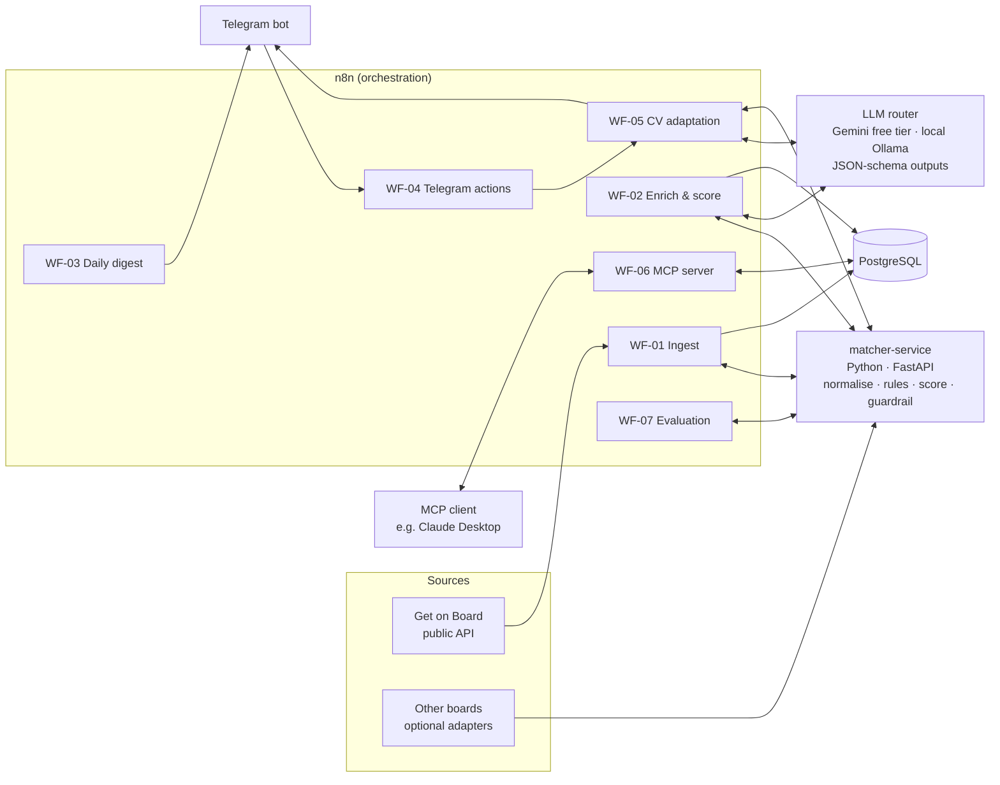

# n8n Job-Matching Agent


[](https://github.com/iramosv2000/n8n-job-matching-agent/actions/workflows/ci.yml)
-EA4B71)


An AI process-automation system that collects engineering job offers from Chilean job
boards and scores each one against a candidate profile. It uses an LLM to extract
structured requirements, notifies the candidate through Telegram with human-in-the-loop
actions, and generates tailored CV sections. A deterministic guardrail checks that the
generated CV never claims experience the candidate does not have.

The project is a **re-platforming case study**. A working single-user Python tool (the
*As-Is* baseline) is migrated to an orchestrated architecture built on **n8n**, a Python
microservice and PostgreSQL (the *To-Be*). The migration is measured: the new system is
evaluated against the old one on a manually labelled dataset, with explicit metrics. The
claim is not simply "it works better".

> **Status: M1 complete (local platform).** n8n and PostgreSQL run with Docker Compose,
> workflows are versioned in Git, and CI runs quality, secret-scan and stack smoke tests.
> The local LLM was selected by benchmark: `qwen3.5:9b`
> ([report](docs/spikes/M1-07-local-llm-benchmark.md)). Next: M2 ingestion. Progress is
> tracked in [GitHub milestones](https://github.com/iramosv2000/n8n-job-matching-agent/milestones)
> and [`docs/roadmap.md`](docs/roadmap.md).

---

## Why this project

| Problem in the current tool (As-Is) | Response in this project (To-Be) |
|---|---|
| Runs only when launched manually from a terminal | Scheduled n8n workflows with error alerts |
| Results live in a local HTML panel | Daily Telegram digest with action buttons (generate CV / discard / applied) |
| No application tracking | Application status stored per offer, with a weekly funnel report |
| Rule-based extraction with unknown accuracy | Rules + LLM structured extraction, **both measured** against labelled data |
| CV generation tied to a local CLI session on one paid account | Versioned workflow on a **local** model with schema-validated output and a fabrication guardrail |
| Single-user SQLite, logic and orchestration mixed | PostgreSQL; orchestration (n8n) separated from tested domain logic (Python) |

The full process analysis is in [`docs/process-analysis.md`](docs/process-analysis.md).

## Architecture (target)



**Design principles:** the system runs at **zero operating cost**, and **personal data
never leaves the machine** ([ADR-0007](docs/adr/0007-zero-cost-provider-agnostic-llm.md)).
Public offer text goes to the Gemini API free tier, with a local fallback. The CV is
processed only by a local model served by Ollama. n8n orchestrates (schedules, branching, retries, integrations,
human approval). Deterministic logic such as parsing, scoring, deduplication and the
guardrail lives in a unit-tested Python service. The LLM handles only the tasks where
rules are known to be weak. The rationale is in [ADR-0001](docs/adr/0001-n8n-orchestrates-python-computes.md).

## Quick start (local platform)

Requires a Docker engine with Compose v2 (Colima or Docker Desktop on macOS, Docker
Engine on Linux). Details, secrets handling and troubleshooting:
[`infra/README.md`](infra/README.md).

```bash
scripts/init_env.sh            # .env with random secrets (git-ignored); back up N8N_ENCRYPTION_KEY
docker compose up -d --wait    # PostgreSQL + n8n, health-checked
scripts/smoke_test.sh          # readiness, schemas, workflow import, export checks
pre-commit install             # local quality, secret and personal-data hooks
```

n8n is then available at <http://localhost:5678>, bound to localhost only.

## Repository layout

```
├── docs/                 Design documentation (start here)
│   ├── architecture.md       Components, workflow catalogue, sequences, NFRs
│   ├── process-analysis.md   As-Is → To-Be analysis and module mapping
│   ├── data-model.md         PostgreSQL schema (logical)
│   ├── evaluation-plan.md    Research questions, labelling protocol, metrics
│   ├── data-governance.md    Sources policy, personal data, secrets, LLM data flow
│   ├── roadmap.md            Milestones, deliverables, acceptance criteria
│   └── adr/                  Architecture Decision Records
├── workflows/            Exported n8n workflows (JSON, no credentials)      [M1+]
├── services/matcher/     Python FastAPI service + tests                     [M2+]
├── db/migrations/        SQL migrations                                     [M2]
├── profiles/example/     Fictitious example profile and CV (no real data)   [M3]
├── evals/                Labels, evaluation harness, results                [M6]
├── infra/                Docker Compose for n8n + PostgreSQL + service      [M1]
└── scripts/              Workflow export/import and utilities               [M1]
```

## Roadmap

| Milestone | Outcome |
|---|---|
| **M0 Design** | Architecture, ADRs, data model, evaluation plan, backlog |
| **M1 Local platform** | `docker compose up` brings up n8n and PostgreSQL; workflows versioned through the CLI; CI and hooks; local model benchmarked |
| **M2 Ingestion** | Scheduled ingestion from Get on Board (plus optional adapters), deduplicated into PostgreSQL |
| **M3 Enrichment & scoring** | Rule extraction ported with parity tests; LLM structured extraction; scoring |
| **M4 Notifications (MVP)** | Telegram digest, action buttons, application tracking, error alerts |
| **M5 CV agent + guardrail** | Schema-validated CV sections; fabrication guardrail with retry-on-violation |
| **M6 Evaluation & observability** | Labelled dataset; rules vs Gemini (free) vs local model vs hybrid; latency and quota use |
| **M7 MCP & case study** | n8n MCP server; demo; written case study with results |

Details and acceptance criteria are in [`docs/roadmap.md`](docs/roadmap.md).

## Responsible-use principles

- **No fabrication.** The CV agent may only reorder, rephrase and prioritise facts that
  are present in the master CV or explicitly confirmed by the candidate. A deterministic
  validator enforces this rule, so it does not depend on the prompt alone.
- **Polite, transparent collection.** The primary source is a documented public API. The
  optional adapters respect `robots.txt`, rate limits and an identifiable User-Agent.
  Collected offer texts are **not** redistributed in this repository.
- **Personal data stays local.** The CV is processed only by a local model. Free-tier
  external APIs receive only public offer text, with contact details redacted.
- **No personal data in Git.** The real CV, profile, secrets and collected data are
  excluded. Tests use synthetic fixtures.

See [`docs/data-governance.md`](docs/data-governance.md).

## Tech stack

n8n Community Edition (self-hosted, Docker) · Python 3.12 · FastAPI · Pydantic · pytest ·
PostgreSQL · Gemini API (free tier) · Ollama (local open-weight models) · Telegram Bot API ·
Model Context Protocol (MCP) · GitHub Actions. The Claude API is supported as an optional
provider. Every component has a no-cost option.

## Resumen (español)

Sistema de automatización de procesos con IA que migra un buscador de empleo hecho en
Python a una arquitectura orquestada con **n8n**, un microservicio Python y PostgreSQL.
El sistema reúne ofertas de portales chilenos y extrae requisitos con un LLM (salidas
estructuradas). Las ofertas relevantes se notifican por Telegram, con aprobación humana,
y el sistema genera secciones de CV adaptadas, protegidas por un validador que impide
inventar experiencia. La migración se evalúa contra el sistema original con un conjunto
de ofertas etiquetado a mano. Opera con **costo cero**: las ofertas (datos públicos) se
procesan con el nivel gratuito de la API de Gemini, y el CV solo con un modelo local
(Ollama), de modo que los datos personales no salen del equipo.

## Author

**Ignacio Ramos Valenzuela**, Ingeniero Civil Electrónico (embedded systems, control,
applied AI). GitHub: [@iramosv2000](https://github.com/iramosv2000)

## License

[MIT](LICENSE)
