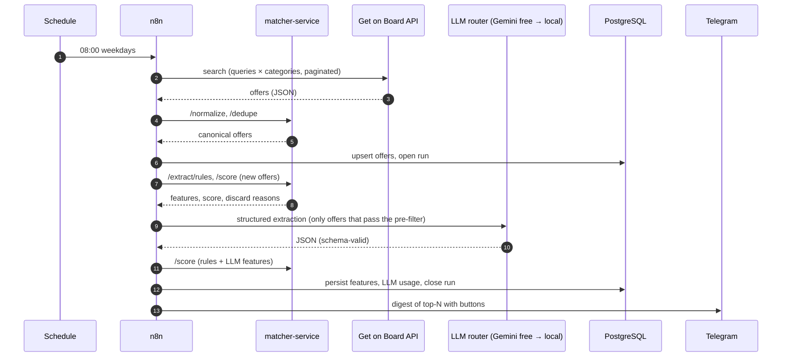
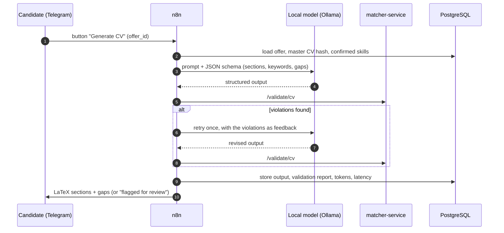

# Architecture

This document describes the target (To-Be) architecture. Decisions and their alternatives
are recorded in [`adr/`](adr/). The baseline system and the reasons for migrating are in
[`process-analysis.md`](process-analysis.md).

## 1. Context and scope

**Goal.** Reduce the time between an offer being published and a well-targeted
application, without lowering the factual accuracy of what is sent to the employer.

**In scope:** collection of offers, normalisation, deduplication, requirement extraction,
scoring against a profile, notification, application tracking, CV-section generation with
a guardrail, evaluation, and an MCP interface for conversational queries.

**Out of scope:** automatic submission of applications (always human), scraping of boards
that forbid it or need authentication (LinkedIn, Indeed, Laborum), and multi-tenant use.

## 2. Components

| Component | Technology | Responsibility | Must not do |
|---|---|---|---|
| **Orchestrator** | n8n Community Edition, self-hosted in Docker | Schedules, control flow, retries, integrations (HTTP, Telegram, PostgreSQL, LLM providers), human-in-the-loop, error handling | Hold business logic that needs unit tests |
| **matcher-service** | Python 3.12, FastAPI, Pydantic | Source adapters (HTML/JSON-LD), normalisation, rule-based extraction, scoring, deduplication, CV guardrail validator | Call the LLM, or hold orchestration state |
| **Database** | PostgreSQL 18 (migrations: dbmate) | System of record for offers, features, applications, LLM calls and runs; also n8n's own database (separate schema) | — |
| **LLM router** | n8n sub-workflow (WF-10) | Applies the per-task provider policy, enforces JSON-schema output, handles quota fallback and logs every call ([ADR-0007](adr/0007-zero-cost-provider-agnostic-llm.md)) | Send personal data to an unpaid external service |
| **LLM providers** | Gemini API free tier (public data); Ollama, native on the host (personal data); Claude API (optional) | Requirement extraction and CV-section generation | Make final decisions; the score and the guardrail are deterministic |
| **Notification channel** | Telegram Bot API | Daily digest, action buttons, alerts, delivery of generated `.tex` sections | Expose personal data in group chats (private chat only) |
| **MCP interface** | n8n MCP Server Trigger | Exposes read-only tools (search, offer detail, status) and one gated action (generate CV) to MCP clients | Expose write operations without confirmation |

## 3. Workflow catalogue (n8n)

| ID | Name | Trigger | Summary | Milestone |
|---|---|---|---|---|
| WF-01 | `ingest-sources` | Schedule (weekdays, 08:00 America/Santiago) | Fetch each source → call `/normalize` → upsert `offers` → record `runs` | M2 |
| WF-02 | `enrich-and-score` | Called by WF-01 | For new or changed offers: `/extract/rules` → LLM extraction via WF-10 (only for offers that pass the rule pre-filter) → `/score` → persist `offer_features` | M3 |
| WF-03 | `daily-digest` | Called by WF-02 | Top-N new offers above threshold → Telegram message with inline buttons | M4 |
| WF-04 | `telegram-actions` | Telegram Trigger (callback queries) | `generate_cv` → WF-05; `discard` / `applied` / `interview` → update `applications` | M4 |
| WF-05 | `cv-adaptation` | Sub-workflow | Build prompt (master CV + protocol + offer) → **local model** via WF-10 → `/validate/cv` → retry once with violations as feedback → deliver or flag (manual mode as fallback) | M5 |
| WF-06 | `mcp-server` | MCP Server Trigger | Tools: `search_offers`, `get_offer`, `application_status`, `request_cv_generation` | M7 |
| WF-07 | `evaluation` | Evaluation trigger / manual | Runs the labelled dataset through the extraction and scoring paths and records the metrics | M6 |
| WF-08 | `error-handler` | Error Trigger | Telegram alert with workflow, node, run ID and error message | M4 |
| WF-09 | `weekly-report` | Schedule (Mondays) | Application funnel, source health, LLM usage and quota per provider | M6 |
| WF-10 | `llm-router` | Sub-workflow | Per-task provider policy, JSON-schema output, 429/quota fallback to local, `llm_calls` logging | M3 |

Workflows are exported with the n8n CLI (`export:workflow --backup`, one pretty-printed
JSON file per workflow) into [`../workflows/`](../workflows/). Credentials are never
exported ([ADR-0006](adr/0006-workflow-versioning.md)).

## 4. matcher-service API (planned)

| Method & path | Purpose | Ported from (As-Is) |
|---|---|---|
| `GET /health` | Liveness and readiness | — |
| `POST /sources/{name}/fetch` | Optional HTML/JSON-LD adapters (rate-limited, `robots.txt`-aware) | `fuentes.py` |
| `POST /normalize` | Canonical offer schema, HTML stripping, region mapping | `analisis.py: quitar_html, extraer_region` |
| `POST /dedupe` | Cross-source duplicate detection (title tokens + company + date window) | `buscar.py: deduplicar` |
| `POST /extract/rules` | Years of experience, contract, schedule, modality, salary | `analisis.py: extraer_*` |
| `POST /score` | 0–100 score with an itemised breakdown and discard reasons | `analisis.py: evaluar` |
| `POST /validate/cv` | Guardrail: every skill and claim in the generated LaTeX must trace to the master CV or the confirmed list | `cv_adaptar.py: analisis_local` (extended) |

All endpoints use Pydantic models. These models are the contract with n8n, and their
JSON Schemas are published at `/openapi.json`.

## 5. Key sequences

### 5.1 Daily run

### 5.2 CV adaptation with guardrail

## 6. Non-functional requirements

| Attribute | Target | How it is verified |
|---|---|---|
| Reproducibility | `docker compose up` on a clean machine reaches a healthy state | CI smoke test (M1) |
| Correctness of domain logic | Ported rules reproduce the As-Is outputs on the same inputs | Parity tests (M3) |
| Factual safety | 0 unsupported claims delivered without a flag | Guardrail tests and audit sample (M5–M6) |
| Cost | Operating cost USD 0; quota use per provider and latency per task reported | `llm_calls` table, weekly report (M6) |
| Privacy | CV and career data processed only by the local provider | Router policy unit test; egress check (M5) |
| Politeness | ≥ 0.8 s between requests per host; `robots.txt` honoured | Adapter tests (M2) |
| Observability | Every run has a `run_id`, per-source counts and errors | `runs` table and WF-08 alerts |
| Security | No secrets or personal data in Git | `.gitignore` and CI secret scan (M1) |

## 7. Deployment

The deployment is local-first: Docker Compose on the candidate's machine, with n8n,
PostgreSQL and matcher-service on a private network. **Ollama runs natively on macOS**,
because Docker containers on macOS cannot use the Apple GPU, and n8n reaches it at
`host.docker.internal:11434`. Only three kinds of traffic leave the host: Telegram, the
Gemini API (public, redacted offer text only) and the job-board sources. A cloud
deployment is optional and out of scope for v1. It would need a host able to run the
local model.

## 8. Risks and mitigations

| Risk | Likelihood | Impact | Mitigation |
|---|---|---|---|
| A board changes its HTML or JSON structure | High | Medium | Primary source is a documented API; adapters are isolated and fail per source, never globally |
| n8n's Gemini/Ollama nodes do not enforce a JSON schema | Medium | High | Verify in M1-06. Fallback: HTTP Request node calling the native APIs with a response schema (Gemini) or the `format` parameter (Ollama) |
| Gemini free-tier quota is reduced or removed | Medium | Medium | Router falls back to the local model; quota re-checked in AI Studio before M3 |
| Local model too weak or too heavy for 16 GB alongside Docker | Medium | High | Benchmark in M1-07; guardrail (ADR-0005); manual mode for the CV as a last resort |
| MCP transport incompatible with stdio-only clients | Medium | Low | The MCP Server Trigger supports SSE and streamable HTTP; use a bridge (e.g. `mcp-remote`) and verify in M7 |
| Scope creep | High | High | MVP closes at M4; M5–M7 are additive and independently demonstrable |
