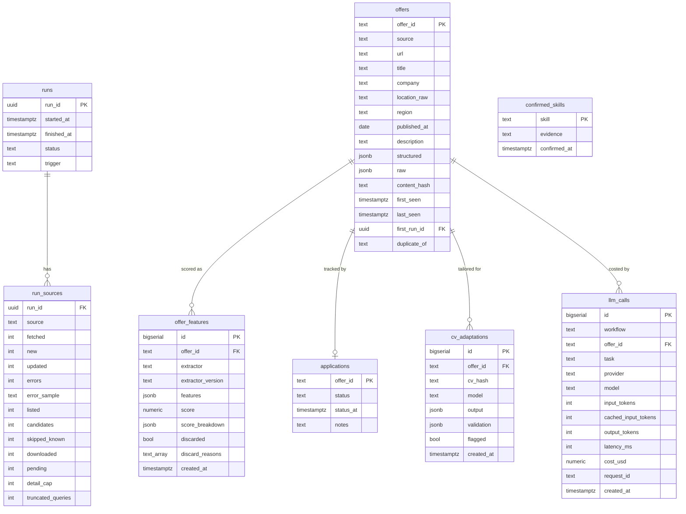

# Data Model (logical)

Target: PostgreSQL 18, schema `jobs`. n8n stores its own state in a separate schema
(`n8n`) of the same instance. Physical DDL is delivered as versioned migrations in
[`../db/migrations/`](../db/migrations/) during M2.



## Table notes

| Table | Notes |
|---|---|
| `run_sources` fetch statistics | **Added in M2-06** (migration `20261022000001`) for capped sources: `listed`, `candidates`, `skipped_known`, `downloaded`, `pending` (backlog left by `detail_cap`) and `truncated_queries` (queries whose page limit cut off in-window offers). NULL for API sources and for runs that could not be reconstructed. |
| `runs`, `run_sources` | **Implemented in M2-01.** `status` ∈ {`running`, `succeeded`, `partial`, `failed`}; `trigger` ∈ {`schedule`, `manual`, `test`}. One `run_sources` row per source and run, with fetched/new/updated/error counts. |
| `offers` | **Implemented in M2-01.** `offer_id` = `{source}:{native_id}`. `description` is redacted plain text; `structured` holds source-reported fields; `raw` is the unredacted payload, cleared by `jobs.purge_offer_texts(180)`. `content_hash` detects edits to an existing offer. `duplicate_of` links cross-source duplicates rather than deleting them, so the deduplication decision stays auditable. |
| `offer_features` | **Append-only.** One row per extractor run (`extractor` ∈ {`rules`, `llm`, `hybrid`}) and version, so extractors can be compared on the same offers (needed in M6). The current view picks the latest `hybrid` row. |
| `applications` | `status` ∈ {`new`, `shortlisted`, `cv_generated`, `applied`, `interview`, `offer`, `rejected`, `discarded`}. Transitions are written only by WF-04 or by MCP tools with confirmation. |
| `cv_adaptations` | `cv_hash` is a SHA-256 of the master CV, so outputs made from an older CV can be detected and regenerated. `validation` stores the guardrail report. |
| `confirmed_skills` | Skills absent from the master CV that the candidate confirmed holding, each with free-text evidence. These are the only additions the CV agent may use. |
| `llm_calls` | One row per LLM request: `provider` (`gemini_free`, `ollama`, `claude_api`), model, token usage, latency, and the provider's request ID when available. These rows drive quota tracking and fallback routing. `cost_usd` is 0 for free providers and is kept for the optional paid provider. |

## Canonical offer schema (contract between n8n and matcher-service)

Defined by `CanonicalOffer` in [`services/matcher/src/matcher/models.py`](../services/matcher/src/matcher/models.py)
and published as JSON Schema at `/openapi.json`. Example (fictitious):

```json
{
  "offer_id": "getonbrd:ingeniero-a-de-automatizacion-andes-procesos-ficticia",
  "source": "getonbrd",
  "url": "https://www.getonbrd.com/jobs/…",
  "title": "Ingeniero/a de Automatización",
  "company": "Andes Procesos SpA",
  "location_raw": "Calama",
  "region": "Antofagasta",
  "published_at": "2026-10-15",
  "description": "… Contacto: [email] …",
  "redactions": 1,
  "structured": {
    "contract": null, "schedule": "Full time", "remote_modality": "no_remote",
    "seniority": "Semi Senior", "salary_min_clp": 1900000, "salary_max_clp": 2280000,
    "salary_note": "USD 2000–2400 /mes", "countries": ["Chile"], "outside_chile": false
  },
  "content_hash": "<sha256 of normalised title, company, description>",
  "raw": { "…": "unredacted source item" }
}
```

## Retention

Collected offer texts are kept locally only for as long as the evaluation needs them. The
default is 180 days, after which `description` and `raw` are purged and labels and
features are kept. See [`data-governance.md`](data-governance.md).
