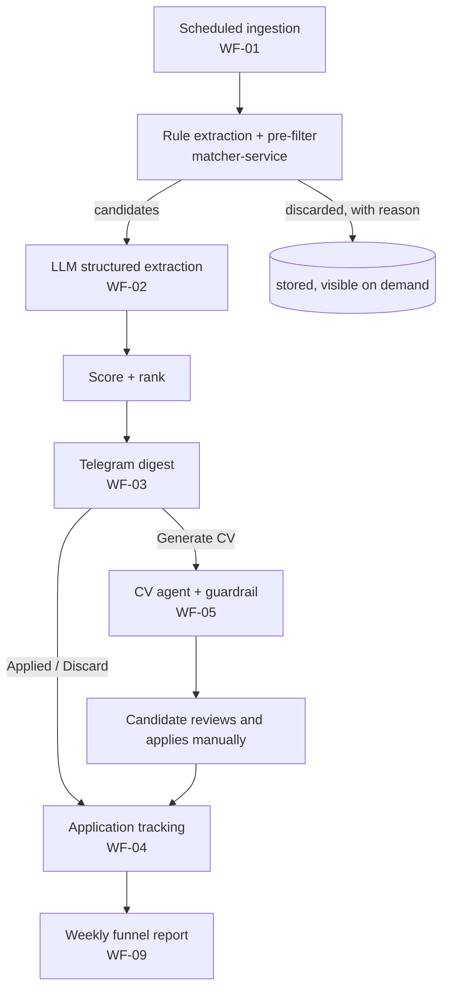

# Process Analysis: As-Is → To-Be

## 1. The process being automated

A candidate (here, a civil electronic engineer looking for roles in electronics,
automation and applied AI in Chile) repeats the following loop:

1. Search several job boards with many queries.
2. Read each offer and decide whether it fits (experience required, contract, salary,
   location, technical match).
3. For promising offers, tailor the CV, which is a one-page LaTeX document, without
   misrepresenting experience.
4. Apply, then track the outcome.

## 2. As-Is: the current Python tool

The baseline is a working local tool of about 1,800 lines of Python that is not part of
this repository:

| Module | Lines | Responsibility |
|---|---|---|
| `buscar.py` | 333 | CLI entry point, deduplication, CSV export, batch CV generation |
| `fuentes.py` | 438 | Four source adapters: Get on Board (public API), Trabajando.cl (site JSON), Computrabajo and Chiletrabajos (HTML + JSON-LD); rate-limited client; USD→CLP rate |
| `analisis.py` | 464 | Normalisation and rule-based extraction (years, contract, schedule, modality, salary, region); 0–100 scoring with discard rules |
| `historial.py` | 107 | SQLite history (offers, runs, CV adaptations, confirmed skills) |
| `cv_adaptar.py` | 244 | Local keyword gap analysis; LLM CV adaptation via the Claude Code CLI (`claude -p`) with a JSON schema |
| `panel.py`, `servidor.py` | 197 | Static HTML panel and a local HTTP server for on-demand CV generation |

**Observed volume.** A 21-day window produced 665 unique offers, of which 312 were not
auto-discarded and 69 scored ≥ 70. The second daily run added 121 new offers. That
figure is a single observation and must not be read as a daily rate. M2 will measure the
real arrival rate.

### 2.1 Pain points

| # | Pain point | Consequence |
|---|---|---|
| P1 | Runs only when started manually (or through a hand-edited `crontab`) | Offers are seen late; the routine depends on discipline |
| P2 | Output is a local HTML panel; nothing is pushed to the user | Good offers go unnoticed |
| P3 | No record of what was applied to, or of outcomes | No funnel metrics; duplicate applications are possible |
| P4 | The accuracy of rule-based extraction is unknown | Scoring errors are invisible; there is no basis for improving it |
| P5 | LLM generation depends on an interactive CLI login on one machine | Not portable or containerisable; not reproducible by a reviewer |
| P6 | Orchestration, I/O and domain logic share the same modules; there are no tests | Changes are risky; the logic cannot be reused |
| P7 | SQLite with a single writer | Concurrent workflows (ingestion and user actions) would conflict |

## 3. To-Be: target process

**Decisions that stay human:** whether to apply, what to send, and any confirmation that
a skill is genuinely held.

## 4. Mapping As-Is → To-Be

| As-Is element | To-Be element | Change |
|---|---|---|
| `buscar.py` main loop | WF-01 + WF-02 (n8n) | Orchestration moves to n8n; adds retries, alerts and a `run_id` |
| `fuentes.getonbrd` | n8n HTTP Request node | Documented public API, so no custom code is needed |
| Other `fuentes.*` adapters | `POST /sources/{name}/fetch` | Optional, isolated, tested with synthetic fixtures |
| `analisis.extraer_*`, `evaluar` | `POST /extract/rules`, `POST /score` | Ported with **parity tests** against As-Is outputs |
| (none) | LLM structured extraction (Gemini free tier → local fallback) | New; its value is measured in M6, not assumed |
| `historial.py` (SQLite) | PostgreSQL schema | Multi-writer; application tracking; LLM usage accounting |
| `cv_adaptar.generar` (`claude -p`) | WF-05 + local model (Ollama) via WF-10 | Zero cost; personal data stays local; schema-validated; guardrail and retry |
| `cv_adaptar.analisis_local` | `POST /validate/cv` | Extended from gap listing to claim traceability |
| `panel.py` / `servidor.py` | Telegram digest + MCP server | Push instead of pull; conversational queries |

## 5. Success criteria for the migration

Each criterion maps to a pain point and is tested in M6
([`evaluation-plan.md`](evaluation-plan.md)):

- **P1/P2:** median delay between an offer's first appearance and its notification is ≤ 1
  working day.
- **P3:** 100 % of offers acted on through Telegram have a recorded status.
- **P4:** extraction accuracy is reported per field, with 95 % confidence intervals, for
  rules, LLM and hybrid.
- **P5/P6:** a reviewer can run the system from a clean clone with documented steps, and
  the domain logic has automated tests.
- **Safety:** no CV output containing an unsupported claim reaches the candidate unflagged.
